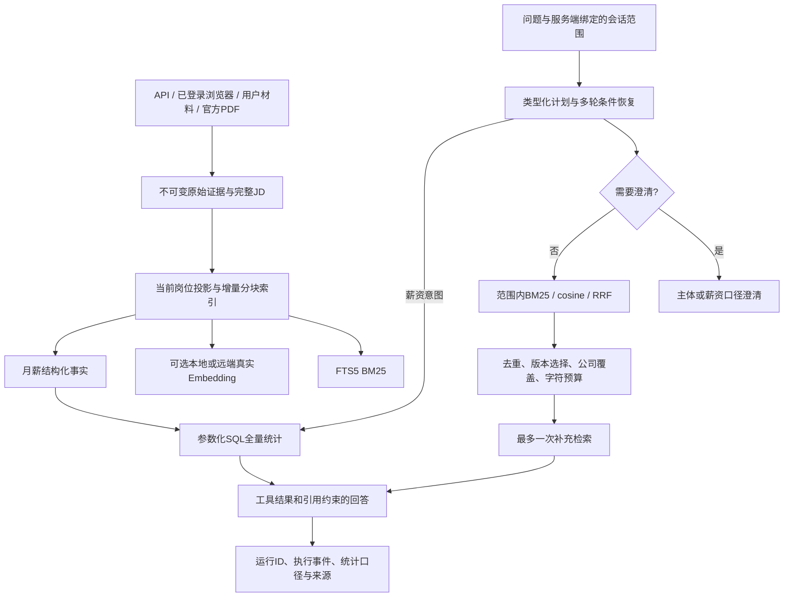

# 把知根作为 AI Agent 工程项目讲清楚

这个项目的核心问题是：求职者面对数百个岗位和混杂的公司材料，需要可以回查出处的判断。不同问题需要不同执行方式。“这家公司做什么”需要证据检索；“杭州 RAG 月薪下限超过 25K 有多少岗位”需要完整集合上的结构化统计；“实际到手多少”需要当前没有的数据，系统必须承认缺失。

## 已实现的架构

这是有界研究工作流。模型可辅助解析问题和综合回答；代码控制访问范围、金额条件、工具面和停止条件。当前没有接入生成模型密钥，因此实际工作台展示规则计划、真实查询结果和证据摘录。模型辅助路径有错误与引用校验测试，生成回答的语义质量尚未做在线验收。

## 面试中值得展开的六个设计

1. **检索与分析分离。** BM25 或向量取回最多 8 份来源，不能用这 8 份统计全库。薪资工具使用参数化 SQL，先应用公司、城市、技能 AND/OR，再按月薪上下限筛选。返回全量命中数、未知数量、最多 8 个可核对样本。代码不执行模型生成的 SQL。
2. **范围进入工具查询。** 岗位、精确公司、全局是服务端会话绑定。FTS、向量候选、样本回读和统计分别应用范围条件。跨范围复用会话拒绝。未知主体需要选择，品牌、集团和子公司不隐式合并。这是个人工作区的上下文隔离，尚不是多人租户权限。
3. **原始资料与当前投影分开。** 原文以内容 hash 保留修订，查询只索引岗位当前快照。`research_job_documents` 单独维护岗位与证据关系，避免两条相同 JD 共用快照时丢失岗位访问。正文分块保留偏移和 PDF 页码；向量按模型标识和内容 hash 缓存，批次提交可复用已完成进度。
4. **多轮条件是状态，不是聊天拼接。** 只从服务端用户历史恢复条件；“那乙公司呢”保留工资、城市、技能和金额，替换公司。年薪不能解释为月薪。用户明确改为月薪后可解除澄清。最终校验字段生成执行问题，避免模型改写成北京而工具实际查杭州。
5. **失败路径也是产品行为。** 无结果、未知公司、年薪口径、模型空响应、非法结构、向量维度错误、模型引用越界都有明确处理。外部调用有超时和响应大小上限。最多一次计划模型、一次回答模型、两次检索和一次薪资工具，没有无限重试。输入证据上限 24,000 字符；这不是完整 token 或费用预算。
6. **执行记录可以复盘。** 运行记录持久保存范围、计划、工具耗时、候选数量、降级、引用和统计。前端折叠展示这些动作记录。记录不展示内部思维链，也不把“引用 ID 存在”解释为结论已得到语义证明。

## 为什么保留 SQLite，为什么不堆框架

当前规模是数百岗位和数百分块，SQLite FTS5、参数化聚合及精确余弦足以支持可复现的本地实验。这样能直接观察检索、实体过滤、版本与统计的行为。当前向量召回会读取范围内的全部向量做精确计算；数据规模达到数万至十万分块时，应迁移到具备过滤能力的 ANN 引擎，再用召回率和延迟验证迁移。不能将当前实现描述为大规模向量数据库。

没有为了展示术语加入多 Agent、知识图谱或 LangGraph。状态图目前较短，普通 Python 编排便于控制和测试。采集保留已有后台任务及逐条进度；研究查询与建向量仍为同步请求，尚不具备队列化执行、进程级断点续跑和取消协议。后续有长任务需求时再引入任务队列和幂等任务合同。

## 如何演示

1. 全局问：“杭州 RAG 岗位工资超过 25K 有多少？”展开执行过程，核对月薪下限、完整统计与有限样本。
2. 追问：“那上海呢？”再切换精确公司。展示结构化条件和会话范围。
3. 问“年薪超过 50 万”，观察澄清，再说“那按月薪超过 25K 呢”。
4. 问一个未保存公司的工资，观察没有扩大到全库。问“实际到手工资”，观察招聘报价与实际工资明确分开。
5. 在来源页展示当前来源、分块、岗位事实和可选向量；打开带页码或偏移的出处。
6. 运行 `jobscope/evals/run.py --dense --check`，说明关键词基线、BM25、混合检索的差别和失败样本。测试数据为人工合成，不能据此声称真实用户准确率。

## 下一阶段如何提升

优先积累真实问答标注，拆分调参与留出集；当前语义阈值也在同一小集合上校准，存在过拟合风险。补充回答的逐主张出处支持度评测、冲突资料处理与时效规则，再评估 cross-encoder reranker。公司实体解析应增加用户确认的别名表，当前规则仅覆盖常见表达，不声称通用 NER。对薪资增加地区、职级、币种与可比样本口径；没有真实发薪材料时继续标为未知。多人部署还需要身份认证、租户行级隔离、审计与资料保留策略。

生成模型上线后再实测提示注入、回答事实支持度、取消、重试和成本。当前没有声称网页资料中的指令已获得完备攻击防护，也没有把招聘自述当作独立核实的员工、经营或发展事实。
